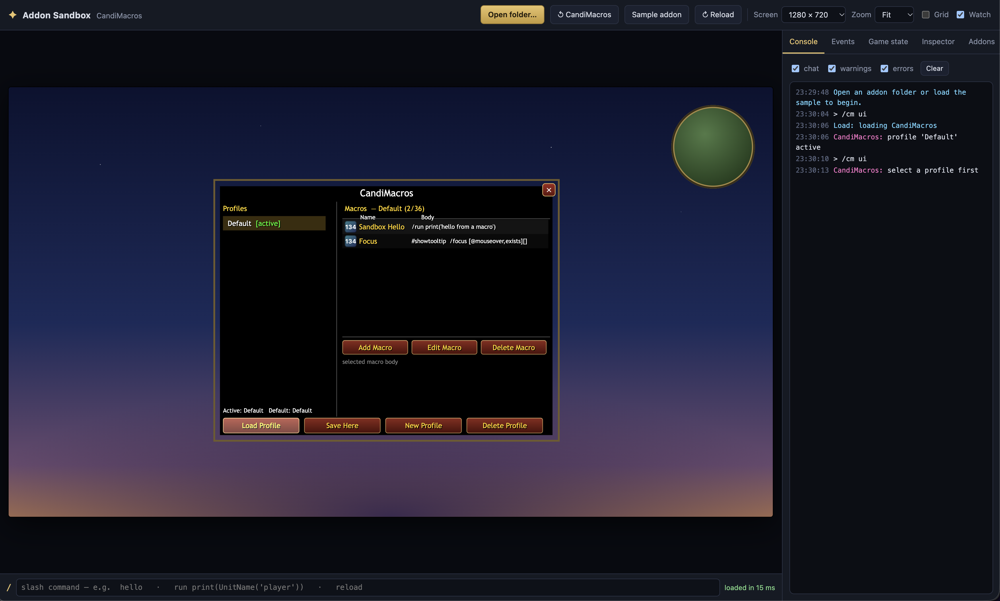

# WoW Addon Sandbox

A browser sandbox that runs World of Warcraft addons (Lua and XML) and renders their frames live, so you can see an addon's UI without launching the game. It reloads when you save files, and has a console, event firing, mock player data, slash commands and a frame inspector.



```
npm install
npm run dev      # open the printed URL (Chrome/Edge recommended)
```

Click **Open folder…** (or drop a folder on the page) and choose an addon folder (contains `<Name>.toc`) or a whole `AddOns` folder. In Chromium the folder is watched, so saving a `.lua`/`.xml`/`.toc` file reloads the addon.

## What is emulated
- TOC parsing, load order, dependencies, `SavedVariables` (kept in localStorage), `local addonName, ns = ...`
- Lua 5.4 (wasmoon) with Lua 5.1 shims: `unpack`, `setfenv/getfenv`, `bit`, `strsplit`, `tinsert`, `hooksecurefunc`, `Mixin`, …
- Frames: Frame, Button, CheckButton, EditBox, Slider, StatusBar, ScrollFrame, GameTooltip, ScrollingMessageFrame; Texture, FontString, fonts, backdrops, anchors, strata/levels, scripts/events, `OnUpdate`, `C_Timer`, animation groups (Alpha/Translation/Scale), dragging
- XML templates (`virtual`, `inherits`, `parentKey`, `$parent`, `mixin`), common built-in templates (UIPanelButton, BasicFrame, UICheckButton, OptionsSlider, InputBox, scroll frames, …)
- Mock game world (player/target units, combat, modifier keys), slash commands (`/run`, `/dump`, `/reload`, `SlashCmdList`), event firing panel, frame inspector

## Game versions
The sandbox targets the **retail (mainline) client API** — modern frame templates (`BackdropTemplate`, `BasicFrameTemplate`), `C_*` namespaces and mixins. It does not yet emulate the differences of other clients.

| Client | Support |
|---|---|
| World of Warcraft: Forever | **Main target, planned.** A standalone flavour launching on November 4, 2026. Gameplay is vanilla-era (level cap 60), but addons are written against the **Mainline API**, not Classic Era / 1.12. Client version 1.60.1, TOC `## Interface: 16001` (the number comes from the live client, not from the retail patch its UI source was built on). Lua is 5.1, like the other clients. Nothing is Forever-specific in the sandbox yet; support will follow as its API is documented. |
| Retail (Midnight) | Primary target. `GetBuildInfo()` currently reports 11.0.7 (The War Within) and is not yet updated to 12.x. |
| Mists of Pandaria Classic, Classic Era, TBC Classic, Cataclysm Classic, Season of Discovery | Not specifically emulated. Addons that only use APIs shared with retail should run; Classic-only APIs and widgets are mostly missing. |

The `## Interface:` number in the `.toc` is read but not enforced, and multi-flavour TOC lists are accepted. Per-client TOC files (`Name_Mainline.toc`, `Name_Vanilla.toc`, …) are not selected yet — the plain `Name.toc` is used.

## Known limits
- Blizzard art isn't shipped: known `Interface\` paths get a stylised stand-in, unknown ones a labelled placeholder. PNG/JPG/TGA files inside your addon render for real; BLP does not.
- Lua 5.4 prints `5.0` for float results when concatenated with `..` (`print`, `tostring` and `string.format` are patched).
- Unimplemented widget methods log a one-time warning and no-op. No secure templates, models, cooldowns, minimap, or dropdown menus yet.
