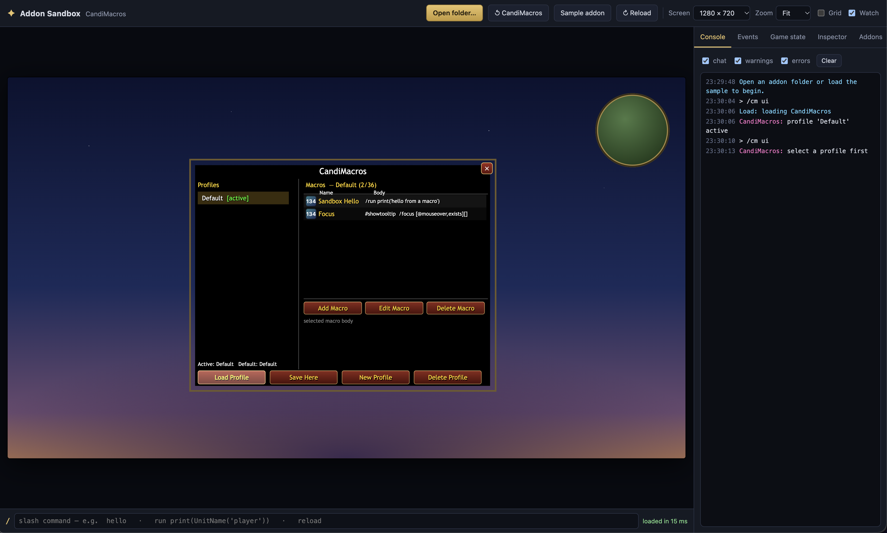

# WoW Addon Sandbox

A browser sandbox that runs World of Warcraft addons (Lua and XML) and renders their frames live, so you can see an addon's UI without launching the game. It reloads when you save files, and has a console, event firing, mock player data, slash commands and a frame inspector.



```
npm install
npm run dev      # open the printed URL (Chrome/Edge recommended)
```

Click **Open folder…** (or drop a folder on the page) and choose an addon folder (contains `<Name>.toc`) or a whole `AddOns` folder. In Chromium the folder is watched, so saving a `.lua`/`.xml`/`.toc` file reloads the addon.

## What is emulated
- TOC parsing, load order, dependencies, `SavedVariables` and `SavedVariablesPerCharacter` (kept in localStorage), `local addonName, ns = ...`
- Lua 5.4 (wasmoon) with Lua 5.1 shims: `unpack`, `setfenv/getfenv`, `bit`, `strsplit`, `tinsert`, `hooksecurefunc`, `Mixin`, …
- Frames: Frame, Button, CheckButton, EditBox, Slider, StatusBar, ScrollFrame, GameTooltip, ScrollingMessageFrame; Texture, FontString, fonts, backdrops, anchors, strata/levels, scripts/events, `OnUpdate`, `C_Timer`, animation groups (Alpha/Translation/Scale), dragging
- XML templates (`virtual`, `inherits`, `parentKey`, `$parent`, `mixin`), common built-in templates (UIPanelButton, BasicFrame, UICheckButton, OptionsSlider, InputBox, scroll frames, …)
- Mock game world (player/target/mouseover units, combat, modifier keys), slash commands (`/run`, `/dump`, `/reload`, `SlashCmdList`), event firing panel, frame inspector
- **Items**: a small item table (cloth, potions, quest items, greens/blues, Thunderfury…) with links and quality colours; `GetItemInfo`/`C_Item.GetItemInfo`, `GetItemInfoInstant`, `C_Item.GetItemNameByID`/`GetItemQualityByID`/`GetItemIconByID`/`RequestLoadItemDataByID`/`IsItemDataCachedByID`, `ITEM_QUALITY_COLORS`, `Enum.ItemQuality`/`ItemClass`, and the `Item` mixin (`Item:CreateFromItemID`, `ContinueOnItemLoad`…). Items load asynchronously like in the game: an uncached item returns nil, then `ITEM_DATA_LOAD_RESULT` / `GET_ITEM_INFO_RECEIVED` fire. Add your own with `/run __RegisterItem(id, { name = "…", quality = 2 })`.
- **Looting**: lootable corpses (spawned from the **Game state** tab, drawn as nameplates at the bottom of the screen; hover for the unit tooltip, click to loot, Shift-click to invert auto loot), `GetNumLootItems`, `GetLootSlotInfo`/`Link`/`Type`, `GetLootSourceInfo`, `GetLootInfo`, `LootSlot`, `CloseLoot`, `ConfirmLootSlot`, `CanLootUnit`, `Enum.LootSlotType`; `LOOT_READY` → `LOOT_OPENED` → `LOOT_SLOT_CLEARED` → `LOOT_CLOSED` in the client's order (slots clear after a short delay, the window closes itself once empty), `LOOT_BIND_CONFIRM` for bind-on-pickup items, area loot of several corpses, a simple `LootFrame`, `CHAT_MSG_LOOT` / `CHAT_MSG_MONEY`
- **Bags and cursor**: a backpack (`C_Container`, `GetItemCount`, `GetMoney`, `BAG_UPDATE`; press **B**), `GetCursorInfo`/`ClearCursor`/`CursorHasItem` with pick-up and drop (`OnReceiveDrag`), `IsModifiedClick`, `HandleModifiedItemClick`/`ChatEdit_InsertLink` (Shift-click links into the focused edit box)
- **Tooltips**: `TooltipDataProcessor.AddTooltipPreCall`/`PostCall` (+ `AllTypes`), `Enum.TooltipDataType`; `SetItemByID`, `SetHyperlink`, `SetBagItem`, `SetLootItem`, `SetUnit` build real lines (quality colour, binding, slot, level, sell price in coins); `GetItem`, `GetUnit`, `GetTooltipData`, `RefreshData`, `TooltipUtil`, `GameTooltip_Hide` and the `GameTooltip_Add*Line` helpers; inline `|T…|t` textures are measured at their real size
- **Options window**: `Settings.RegisterCanvasLayoutCategory`/`RegisterCanvasLayoutSubcategory`/`RegisterAddOnCategory`/`OpenToCategory`, `SettingsPanel:SelectCategory`, legacy `InterfaceOptions_AddCategory`; a Game / AddOns category list with Defaults and Close (`OnDefault`, `OnRefresh`, `OnCommit`). Vertical-layout settings are accepted but not drawn.
- **Key bindings**: `GetBindingKey`, `GetBindingAction`, `SetBinding`, `SaveBindings`/`LoadBindings`, `GetCurrentBindingSet`, `GetBindingText`, override bindings; addons' `Bindings.xml` actions run on key press; default game bindings (B, X, Escape…) so conflicts show; Game › Keybindings page to rebind. Keys use the game's names (`LSHIFT`, `LCTRL`, `SPACE`, `NUMPAD1`…) and route like the game: focused edit box, then keyboard-enabled frames top-down, then bindings. Escape drops the cursor item, closes windows, or opens the game menu.
- **CVars**: real storage with defaults (`autoLootDefault` starts off), `C_CVar.*`, `CVAR_UPDATE`; `SOUNDKIT`
- Client state (changed CVars, saved key bindings, corpses) persists across reloads; the **Addons** tab resets CVars and bindings, the Loot group clears corpses. Events the sandbox fires on its own are logged in the **Events** tab with ◆.

## Game versions
All clients are emulated through the **Mainline API** (modern templates such as `BackdropTemplate`/`BasicFrameTemplate`, `C_*` namespaces, mixins). What differs per client is what `GetBuildInfo()` reports. The **Client** selector in the header picks it, or **Auto** reads the `## Interface:` numbers in your TOC (a multi-flavour list such as `20505, 16001` resolves to the highest-priority client: Forever > Retail > MoP > TBC > Era).

| Client | TOC interface | `GetBuildInfo()` | Status |
|---|---|---|---|
| **World of Warcraft: Forever** (launches November 4, 2026) | `16001` | 1.60.1 | **Main target.** Vanilla-era gameplay (level cap 60), but addons are written against the Mainline API, not Classic Era / 1.12. The interface number comes from the live client, not from the retail patch its UI source was built on. |
| **Retail (Midnight)** | `120007` | 12.0.7 | Main target. |
| Mists of Pandaria Classic | `5xxxx` | 5.5.0 | Mainline API only; Classic-specific APIs aren't emulated. |
| TBC Classic | `20506` | 2.5.6 | Same limitation. |
| Classic Era | `11504` | 1.15.4 | Same limitation. |

Build numbers and dates are placeholders. Lua is 5.4 with 5.1 shims in all modes (the real clients run 5.1). Per-client TOC files (`Name_Mainline.toc`, …) aren't selected yet — the plain `Name.toc` is used.

## Known limits
- Blizzard art isn't shipped: known `Interface\` paths get a stylised stand-in, unknown ones a labelled placeholder. PNG/JPG/TGA files inside your addon render for real; BLP does not.
- Lua 5.4 prints `5.0` for float results when concatenated with `..` (`print`, `tostring` and `string.format` are patched).
- Unimplemented widget methods log a one-time warning and no-op. No secure templates, models, cooldowns, minimap, or dropdown menus yet.
- The item table is small and its stats are illustrative; there's one character, one backpack and no group loot or rolls.
